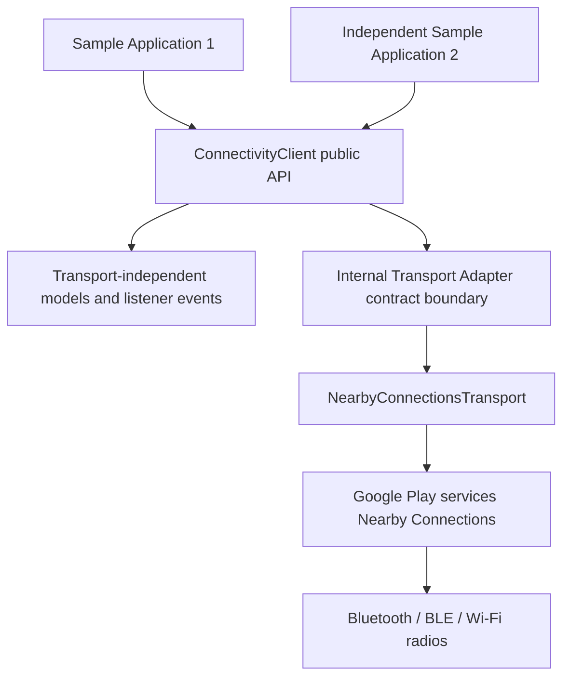

# Architecture

## Boundaries

- Host applications own UI, user decisions, and application-specific behavior.
- `ConnectivityClient` is the host-facing facade. It exposes no Google SDK classes.
- `ConnectivityModels.kt` contains public data models, states, and callback events.
- `TransportAdapter` is the internal technology-neutral boundary; `TransportFactory` selects the current implementation. `NearbyConnectionsTransport` implements that interface and contains all `com.google.android.gms.nearby.*` references. A future adapter can be added behind the same boundary without changing the host-facing facade.
- The existing Wi-Fi/network implementation in any other application is outside this project and is neither imported nor modified.

## Responsibilities

| Concern | Implementation |
|---|---|
| Discovery | `startDiscovery`, `stopDiscovery`, endpoint callbacks |
| Presence | `startAdvertising`, `stopAdvertising` |
| Connection request | `requestConnection` |
| Mutual acceptance | `onConnectionInitiated`, `acceptConnection`, `rejectConnection` |
| Peer verification | Display the same Nearby authentication digits on both devices; each user compares and accepts locally |
| Session | Connected peer set and disconnect callbacks |
| Messaging | UTF-8 JSON envelope in Nearby BYTES payload |
| Cleanup | `disconnectAll`, stop advertising/discovery, `shutdown` |

## Strategy choice

`P2P_CLUSTER` is selected because the requirement says two or more nearby devices and the library should not impose a one-to-one topology. The demo's primary acceptance test remains two physical devices.
